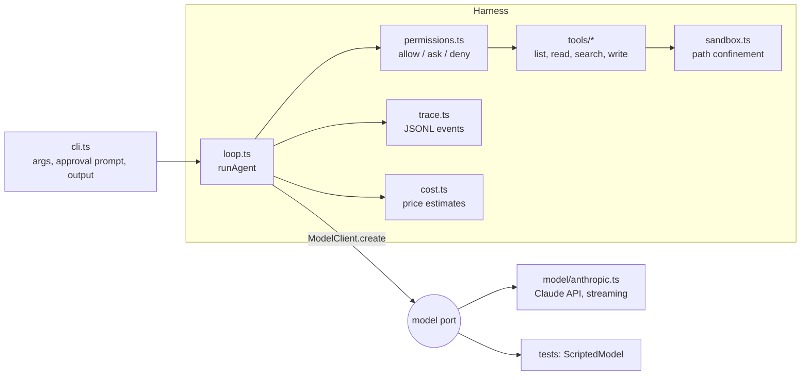

# Architecture

## The loop (`src/loop.ts`)

1. Check limits (turns, cost, tokens, wall clock). Stop with a status, never loop forever.
2. Call the model through the `ModelClient` port (streaming).
3. Add usage and estimated cost, write a trace event.
4. Echo the assistant turn back unchanged, except for the fallback rule below.
5. Act on `stop_reason`:
   `end_turn` finish; `tool_use` run tools; `pause_turn` resend; `max_tokens` stop without
   running a possibly truncated tool call; `refusal` stop and report the category.
6. Run the tool calls: decide (policy), run (validated, time-limited, output-capped), and return
   all results of the turn in **one** user message, in call order.

## Decisions and why

- **Manual loop, not the SDK tool runner.** The harness exists to own the control layer:
  approval gates, per-call timeouts, spend limits, tracing. The SDK runner is the better
  choice when you do not need those.
- **A model port.** The loop depends on `ModelClient`, not on the SDK, so it is tested
  deterministically with a scripted model and the real client is tested separately against a fake
  HTTP server.
- **Risk is a property of the tool, policy is separate.** A tool declares `read` or `write`;
  the policy decides allow/ask/deny. Reads run freely, writes ask by default. Read-only calls
  in one turn run concurrently; anything that writes runs alone, in order.
- **Failures are results.** A refused, invalid or crashing tool call becomes an `is_error` tool
  result so the model can adapt. Unexpected exceptions are replaced by a generic message for the
  model; the detail goes to the trace.
- **Validation at the edge.** Tool arguments are parsed with Zod before `run` sees them; the same
  schema produces the JSON Schema sent to the API (input side, so defaulted fields are optional).
- **Fallback boundary rule.** After a mid-output refusal fallback the API requires dropping
  `thinking` and `tool_use` blocks that precede the last `fallback` block when echoing the turn
  (`echoableContent`). Tools from those dropped blocks are never run.
- **Frozen prompt prefix.** The system prompt has no dates or ids, and caching is on at the top
  level, so repeated turns reuse the cached prefix.
- **No shell tool.** A bash tool would give the harness only an opaque string. Dedicated tools
  have typed arguments the harness can gate, audit and schedule.
